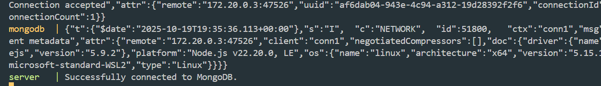
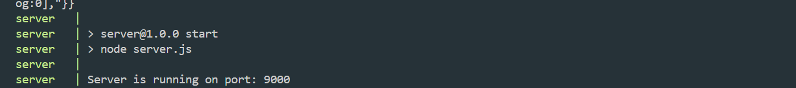
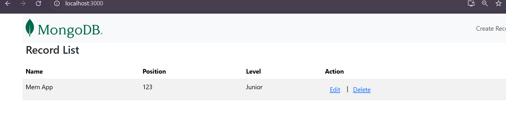
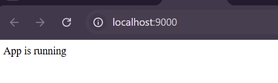

# MERN APP

## captures d’Écran

###  Démarrage des conteneurs


### 2️⃣ Conteneurs actifs


### 3️⃣ API en exécution


### 4️⃣ Application React


## Vue d'Ensemble
Ce projet est une application full-stack composée d’un **client React** et d’un **serveur Node.js (Express)** utilisant **MongoDB** comme base de données.  
**Docker** est utilisé pour la conteneurisation et **Docker Compose** pour orchestrer les différents services.

---

## Table des Matières
- [MERN APP](#mern-app)
  - [captures d’Écran](#captures-décran)
    - [Démarrage des conteneurs](#démarrage-des-conteneurs)
    - [2️⃣ Conteneurs actifs](#2️⃣-conteneurs-actifs)
    - [3️⃣ API en exécution](#3️⃣-api-en-exécution)
    - [4️⃣ Application React](#4️⃣-application-react)
  - [Vue d'Ensemble](#vue-densemble)
  - [Table des Matières](#table-des-matières)
  - [Technologies Utilisées](#technologies-utilisées)
  - [Variables d'Environnement](#variables-denvironnement)

---

## Technologies Utilisées
- **Frontend** : React  
- **Backend** : Node.js, Express  
- **Base de Données** : MongoDB  
- **Conteneurisation** : Docker, Docker Compose  

---

## Variables d'Environnement
Les variables suivantes sont utilisées dans l’application :

| Variable | Description |
|-----------|--------------|
| `REACT_APP_API_URL` | URL du serveur API utilisée par le client React |
| `MONGO_URI` | URI de connexion à MongoDB |
| `SERVER_PORT` | Port sur lequel le serveur Express écoute (par défaut 9000) |
| `CLIENT_PORT` | Port du client React (par défaut 3000) |

Exemple de fichier `.env` :
```bash
MONGO_INITDB_DATABASE=mern_db
MONGO_INITDB_ROOT_USERNAME=admin
MONGO_INITDB_ROOT_PASSWORD=examplepassword
MONGO_URI=mongodb://mongodb:27017/mern_db
SERVER_PORT=9000
CLIENT_PORT=3000
